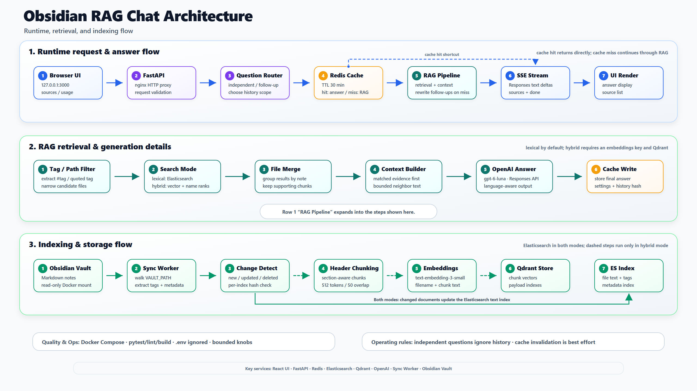
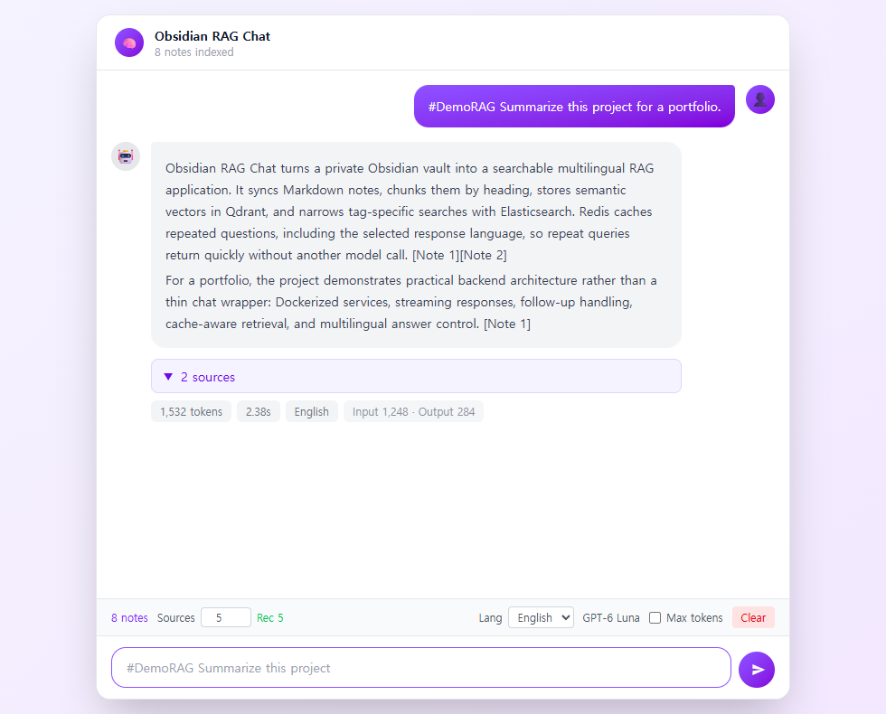
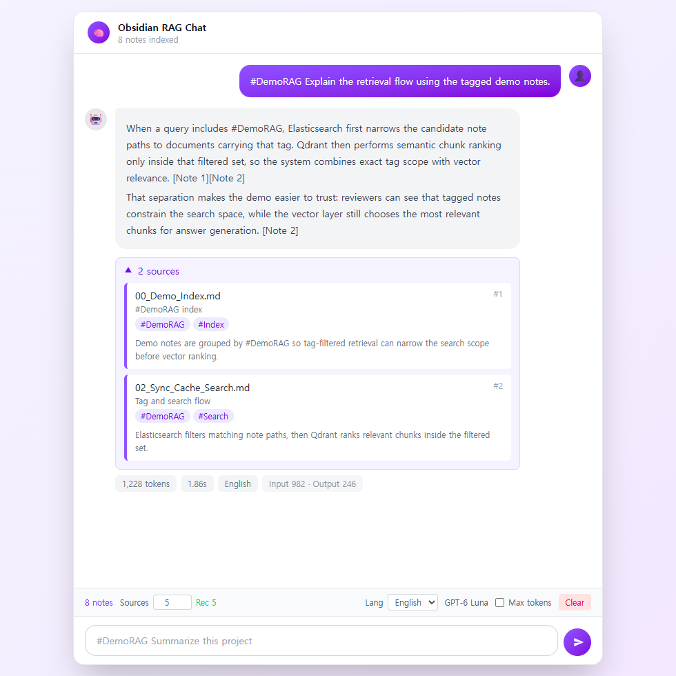

# Obsidian RAG Chat

Ask questions about your Obsidian notes in English, Korean, or Japanese. Search by text or tag with Elasticsearch, or add vector retrieval with Qdrant. Answers stream as they are generated.

[English](README.md) | [한국어](README_KO.md) | [日本語](README_日本語.md)

[](https://www.python.org/downloads/)
[](https://www.docker.com/)
[](https://fastapi.tiangolo.com/)

---

## Architecture



```text
Browser :3000
    |
    v
[nginx] React + Vite + TypeScript
    |  SSE proxy -> /api/*
    v
[app.py] FastAPI
    |- Rule-based independent/follow-up question detection
    |- Redis cache lookup -> immediate response on hit (30 min TTL)
    |
    v
[rag/generator.py]
    |- Follow-up -> query rewrite with previous user topic retained
    |- Tag extraction -> Elasticsearch path filter
    |- Default: Elasticsearch lexical retrieval; optional: Qdrant + filename ranks (RRF)
    |- Exact document copies share a result slot; distinct versions stay separate
    |- response_language control for Korean/English/Japanese answers
    |- Up to 4 supporting chunks per note + bounded neighboring context
    |- gpt-6-luna -> OpenAI Responses text deltas -> SSE
    |
    v
[sync_documents.py]
    |- MD5-based incremental sync
    |- Header-aware chunking (512 tokens, 50 overlap)
    |- Elasticsearch document index
    |- Optional: text-embedding-3-small -> Qdrant chunk upserts
```

Without an embedding key, queries and sync use Elasticsearch only; no Qdrant connection or embedding call is needed. In hybrid mode, reciprocal rank fusion (RRF) combines vector and filename/path ranks, not full-text BM25 and vectors. Explicit folder names help scope project questions without restricting the search to that folder. Filename matches do not overwrite vector similarity scores; multiple supporting chunks are kept within a per-note token budget. New vectors are uploaded before old ones are removed; Qdrant and Elasticsearch are checked independently so partial sync failures can be retried.

---

## Demo

The screenshots use public synthetic notes and scripted hybrid search, follow-up, and cache-hit examples. The displayed answers, timing, and usage are illustrative, not live model outputs or performance measurements.

### Start Screen


### Answer Screen



### Tag-Filtered Answer



### Follow-Up Answer


### Cache Hit


Open `http://127.0.0.1:3000?lang=en` for the start screen. Add `&demo=answer`, `&demo=tag`, `&demo=followup`, or `&demo=cache` to load the corresponding sample conversation.

---

## Stack

| Role | Technology |
|------|------------|
| Frontend | React 19 + Vite 8.3.8 + TypeScript + Tailwind CSS v4 |
| API | FastAPI (Python 3.11+) |
| Vector DB | Qdrant (optional, hybrid mode) |
| Full-text Search | Elasticsearch 8.19.26 |
| Cache | Redis 7.2.17 (30 min TTL) |
| LLM | `gpt-6-luna` (server-selected, OpenAI Responses API) |
| Embedding | text-embedding-3-small (1536 dimensions, filename prefix included) |
| Runtime | Docker + Docker Compose |

---

## Quick Start

```bash
git clone https://github.com/wonhongChang/ObsidianRagChat.git
cd ObsidianRagChat
```

Create a local `.env` from [the example](.env.example). Supply an absolute path to a vault you are authorized to index.

```bash
# Required for answers and follow-up rewriting
OPENAI_API_KEY=
OBSIDIAN_VAULT_PATH=/path/to/your/obsidian/vault

# Optional: leave blank for Elasticsearch-only search
OPENAI_EMBEDDING_API_KEY=
# To explicitly reuse the same key if it permits embeddings, replace the line above with:
# OPENAI_EMBEDDING_API_KEY=${OPENAI_API_KEY}
QDRANT_URL=
QDRANT_API_KEY=
```

The app reads `OPENAI_API_KEY` for answers and follow-up rewriting. A blank `OPENAI_EMBEDDING_API_KEY` selects lexical search; there is no automatic fallback to the generation key. For hybrid search, configure Qdrant and set the embedding variable to a dedicated authorized key or explicitly reference the same key as shown above. Existing `text-embedding-3-small` vectors (1536 dimensions) do not need a forced rebuild. Incremental sync fills missing or changed notes.

Start all services on a new install:

```bash
docker compose up -d --build
```

Open:

```text
http://127.0.0.1:3000
```

Compose publishes the UI and API proxy at `127.0.0.1:3000`, Elasticsearch at `127.0.0.1:9201`, and Redis at `127.0.0.1:6379`. Containers use `elasticsearch:9200` and `redis:6379`. Existing deployments must recreate services for new port bindings to take effect; back up persistent data before a database upgrade. Loopback is not authentication: do not expose these ports through a tunnel, public proxy, or LAN binding without authentication and per-vault access controls.

Uncached answers send the question and selected note excerpts to OpenAI; follow-up rewriting can send relevant chat history. These calls can incur charges even in lexical mode. Hybrid mode also sends note chunks and queries for embedding, and stores vectors and note payloads in the configured Qdrant deployment. Choose an appropriate vault before starting sync.

---

## Usage

```text
"Summarize the Obsidian RAG Chat sync strategy"
"#DemoRAG Explain the cache behavior"
"Then how is the TTL decided?"
```

The app distinguishes standalone questions from follow-ups. Follow-up questions are rewritten into standalone search queries before retrieval, while repeated standalone questions hit Redis with a normalized cache key.

### Multilingual Answers

```text
Response language: Auto / Korean / English / Japanese
```

Vault Markdown is indexed as UTF-8 text. In hybrid mode, all languages share the same embedding model. `response_language` controls generation, not retrieval, and is included in the Redis cache key so answers in different languages do not collide.

---

## API

```json
{
  "query": "Question text",
  "top_k": 5,
  "response_language": "auto",
  "ignore_token_limit": false,
  "history": []
}
```

| Method | Endpoint | Description |
|--------|----------|-------------|
| `POST` | `/api/search` | Full RAG answer |
| `POST` | `/api/search/stream` | For an uncached answer, forwards Responses API text deltas as SSE; cache hits return the stored answer |
| `DELETE` | `/api/cache` | Clear RAG response cache |
| `GET` | `/api/cache/stats` | Cache statistics |
| `GET` | `/api/notes/count` | Indexed note count |
| `GET` | `/health` | Health check |

---

## Project Structure

```text
ObsidianRagChat/
|- app.py                    # FastAPI server, cache, and question routing
|- sync_documents.py         # Incremental sync worker
|- frontend/                 # React + Vite + TypeScript UI
|  |- src/api/stream.ts      # SSE async generator
|  |- src/components/        # Chat UI components
|  |- src/hooks/useChat.ts   # Zustand chat state
|  |- nginx.conf             # SSE proxy configuration
|- embed/
|  |- chunker.py             # Header-aware Markdown chunking
|  |- document_loader.py     # Obsidian Markdown loader
|  |- embedder.py            # OpenAI embedding batch processing
|  |- vector_store.py        # Qdrant collection helpers
|- rag/
|  |- generator.py           # Retrieval, context building, and GPT calls
|  |- context.py             # Matched-evidence-first context assembly
|  |- retrieval.py           # Rank fusion and supporting-chunk grouping
|- search/
|  |- cache.py               # Redis answer cache
|  |- document_index.py      # Elasticsearch indexing
|  |- question_detector.py   # Standalone/follow-up detection
|- scripts/
|  |- clear_cache.py         # Clear Redis cache
|  |- clear_qdrant.py        # Reset Qdrant collection
|  |- add_qdrant_index.py    # Add Qdrant payload indexes
|  |- evaluate_rag.py        # Synthetic context / vector retrieval evaluation
|- tests/
|  |- test_chunker.py
|  |- test_question_detector.py
|  |- test_context.py        # Evidence in all answer paths
|  |- test_sync.py           # Partial failure and retry scenarios
|  |- test_cache.py          # Cache outages and key isolation
|  |- test_indexing.py       # Source/index error handling
|  |- test_evaluation.py     # Evaluation fixture and metrics
|  |- EVALUATION.md          # Methodology, results, and limits
|- docker-compose.yml
|- Dockerfile.frontend
|- Dockerfile.web
|- Dockerfile.sync
|- requirements.txt
```

---

## Commands

```bash
# Check the running app and retrieval mode without printing credentials
curl http://127.0.0.1:3000/health

# Apply app/key changes to a running stack; keep database services and volumes
docker compose up -d --build --no-deps web frontend sync

# Local virtual environment, repository root; synthetic fixtures, no paid calls
python -m scripts.evaluate_rag
```

Clearing either index is not an upgrade or troubleshooting step. The sync worker retries changed documents; check the mounted vault, retrieval mode, and sync errors first.

---

## Verification

Set up a local Python 3.11 virtual environment for tests, install `requirements-dev.txt`, then run regression tests from the repository root:

```bash
python -m pip install -r requirements-dev.txt
python -m pytest tests -q
```

The regression suite covers evidence delivery, indexing retries, and cache outages. On a synthetic set of 10 notes and 30 Korean/English/Japanese questions, known-evidence retention improved from 10/30 to 30/30. A historical vector-only run recorded Recall@5 = 1.000 and MRR@5 = 0.907; it did not score the current lexical mode or answers generated by `gpt-6-luna`.

These are small-fixture checks, **not production answer-accuracy claims**. See [test commands, methodology, and limitations](tests/EVALUATION.md). The full application retrieval path and generated-answer quality need separate real-query evaluation. Deployment is intended for personal use; public multi-user hosting needs authentication and access control.

---

## Security

- Do not commit `.env`; it is covered by `.gitignore`.
- Keep all API keys private. Do not print `.env`, share expanded Compose output, or put keys in the frontend.
- Avoid verbose production logs that expose private vault paths or note contents.
