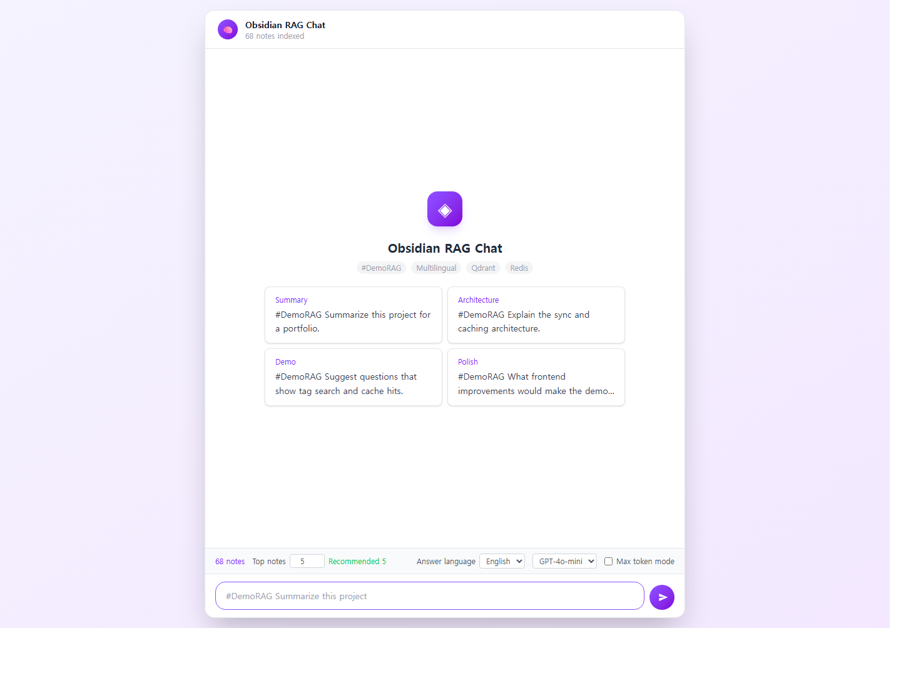
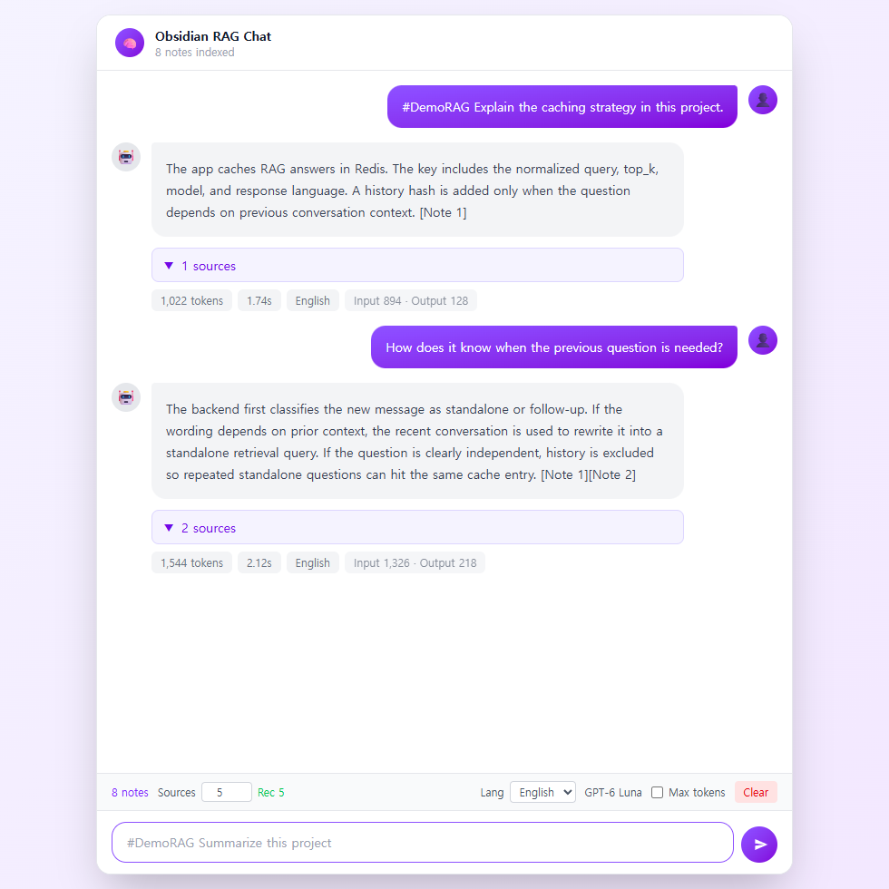
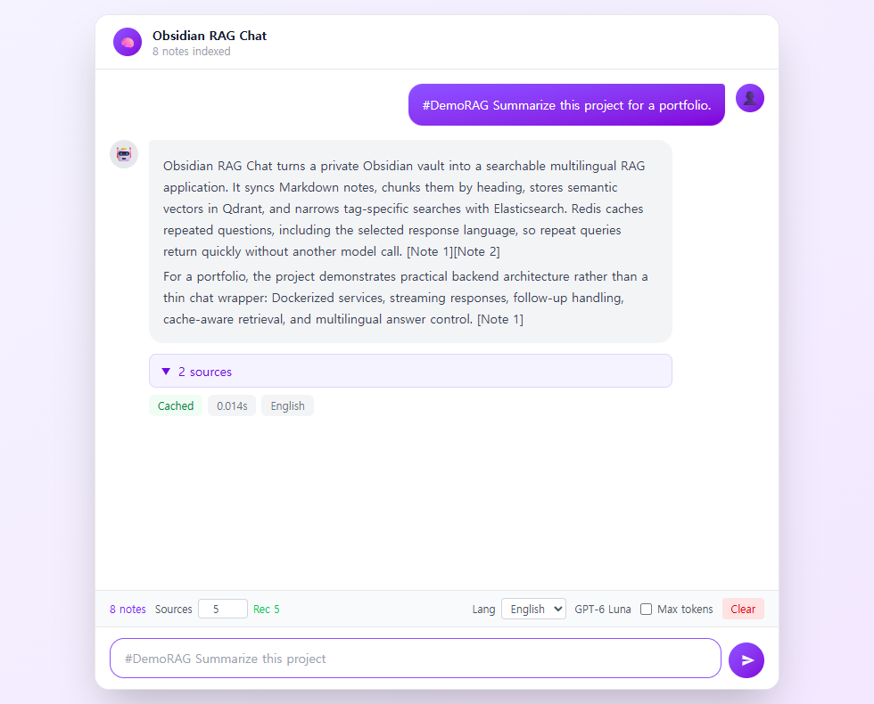

# Obsidian RAG Chat

Turn an Obsidian vault into a multilingual RAG chat interface with semantic search, tag filtering, Redis response caching, and streaming GPT answers.

[English](README.md) | [한국어](README_KO.md) | [日本語](README_日本語.md)

[](https://www.python.org/downloads/)
[](https://www.docker.com/)
[](https://fastapi.tiangolo.com/)

---

## Architecture


```text
Browser :3000
    |
    v
[nginx] React + Vite + TypeScript
    |  SSE proxy -> /api/*
    v
[app.py] FastAPI
    |- Rule-based independent/follow-up question detection
    |- Redis cache lookup -> immediate response on hit (30 min TTL)
    |
    v
[rag/generator.py]
    |- Follow-up -> standalone query rewrite -> vector search
    |- Tag extraction -> Elasticsearch path filter
    |- Qdrant chunk search -> file-level merge -> top-k
    |- Filename keyword boost for Korean/Japanese/CJK notes
    |- response_language control for Korean/English/Japanese answers
    |- GPT answer generation with SSE streaming
    |
    v
[sync_documents.py]
    |- MD5-based incremental sync
    |- Header-aware chunking (512 tokens, 50 overlap)
    |- OpenAI text-embedding-3-small embeddings
    |- Qdrant upsert + Elasticsearch bulk index
```

---

## Demo

### Start Screen



### Answer Screen


### Tag-Filtered Answer


### Follow-Up Answer



### Cache Hit



The demo vault includes `#DemoRAG` notes so reviewers can quickly test tag-filtered retrieval, multilingual answers, repeated-question cache hits, and follow-up behavior. For repeatable English screenshots, open `http://localhost:3000?lang=en`. Add `&demo=answer`, `&demo=tag`, `&demo=followup`, or `&demo=cache` to capture stable demo states. Korean and Japanese screenshots live in their own localized README files.

---

## Stack

| Role | Technology |
|------|------------|
| Frontend | React 19 + Vite + TypeScript + Tailwind CSS v4 |
| API | FastAPI (Python 3.11+) |
| Vector DB | Qdrant Cloud |
| Full-text Search | Elasticsearch 8.18 |
| Cache | Redis 7.2 (30 min TTL) |
| LLM | GPT-4o-mini / GPT-5-mini |
| Embedding | text-embedding-3-small (1536 dimensions, filename prefix included) |
| Runtime | Docker + Docker Compose |

---

## Quick Start

```bash
git clone https://github.com/wonhongChang/ObsidianRagChat.git
cd ObsidianRagChat
```

Create `.env`:

```bash
OPENAI_API_KEY=your_openai_api_key_here
QDRANT_URL=https://your-cluster.cloud.qdrant.io:6333
QDRANT_API_KEY=replace_me
OBSIDIAN_VAULT_PATH=/path/to/your/obsidian/vault

ELASTICSEARCH_HOST=http://elasticsearch:9200
REDIS_HOST=redis
REDIS_PORT=6379

CACHE_TTL=1800
INTERVAL_SECONDS=600
```

Run:

```bash
docker-compose up -d
```

Open:

```text
http://localhost:3000
```

---

## Usage

```text
"Summarize the Obsidian RAG Chat sync strategy"
"#DemoRAG Explain the cache behavior"
"Then how is the TTL decided?"
```

The app distinguishes standalone questions from follow-ups. Follow-up questions are rewritten into standalone search queries before retrieval, while repeated standalone questions hit Redis with a normalized cache key.

### Multilingual Answers

```text
Response language: Auto / Korean / English / Japanese
```

Vault Markdown is indexed as UTF-8 text and embedded into the same vector space with `text-embedding-3-small`. `response_language` controls the generation layer, not the retrieval layer, and is included in the Redis cache key so Korean, English, and Japanese answers for the same query do not collide.

---

## API

```json
{
  "query": "Question text",
  "top_k": 5,
  "model": "gpt-4o-mini",
  "response_language": "auto",
  "ignore_token_limit": false,
  "history": []
}
```

| Method | Endpoint | Description |
|--------|----------|-------------|
| `POST` | `/api/search` | Full RAG answer |
| `POST` | `/api/search/stream` | SSE streaming RAG answer |
| `DELETE` | `/api/cache` | Clear Redis cache |
| `GET` | `/api/cache/stats` | Cache statistics |
| `GET` | `/api/notes/count` | Indexed note count |
| `GET` | `/health` | Health check |

---

## Project Structure

```text
ObsidianRagChat/
|- app.py                    # FastAPI server, cache, and question routing
|- sync_documents.py         # Incremental sync worker
|- frontend/                 # React + Vite + TypeScript UI
|  |- src/api/stream.ts      # SSE async generator
|  |- src/components/        # Chat UI components
|  |- src/hooks/useChat.ts   # Zustand chat state
|  |- nginx.conf             # SSE proxy configuration
|- embed/
|  |- chunker.py             # Header-aware Markdown chunking
|  |- document_loader.py     # Obsidian Markdown loader
|  |- embedder.py            # OpenAI embedding batch processing
|  |- vector_store.py        # Qdrant collection helpers
|- rag/
|  |- generator.py           # Retrieval, context building, and GPT calls
|- search/
|  |- cache.py               # Redis answer cache
|  |- document_index.py      # Elasticsearch indexing
|  |- question_detector.py   # Standalone/follow-up detection
|- scripts/
|  |- clear_cache.py         # Clear Redis cache
|  |- clear_qdrant.py        # Reset Qdrant collection
|  |- add_qdrant_index.py    # Add Qdrant payload indexes
|- tests/
|  |- test_chunker.py
|  |- test_question_detector.py
|- docker-compose.yml
|- Dockerfile.frontend
|- Dockerfile.web
|- Dockerfile.sync
|- requirements.txt
```

---

## Commands

```bash
# Clear Redis cache
docker-compose exec web python scripts/clear_cache.py
curl -X DELETE http://localhost:3000/api/cache

# Rebuild frontend
docker-compose up -d --build --force-recreate frontend

# Run tests
docker-compose exec web python -m pytest tests/ -v
```

---

## Security

- Do not commit `.env`; it is covered by `.gitignore`.
- Keep `OPENAI_API_KEY` and `QDRANT_API_KEY` private.
- Avoid verbose production logs that expose private vault paths or note contents.
