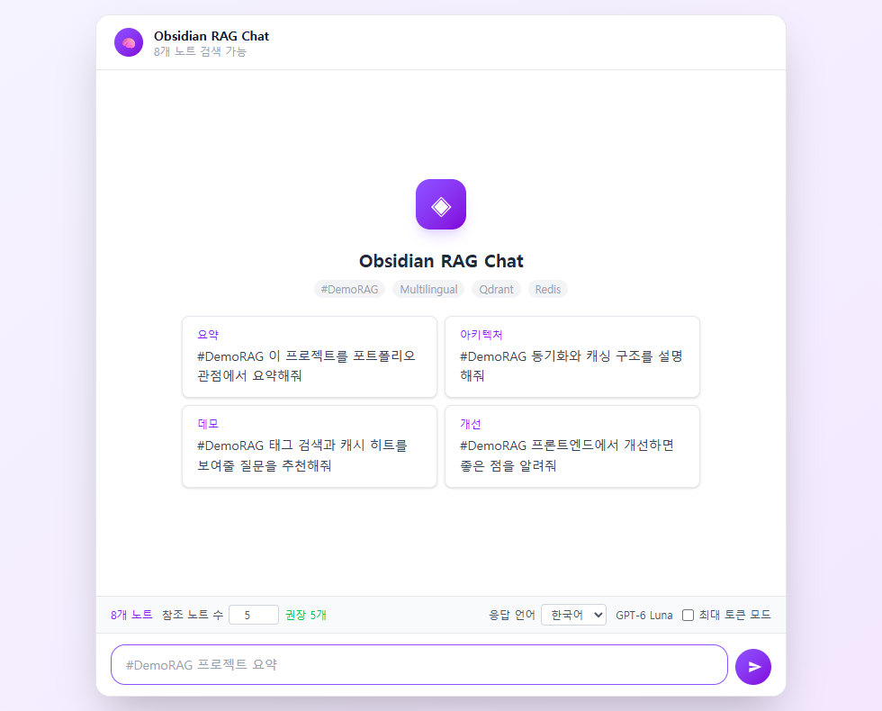
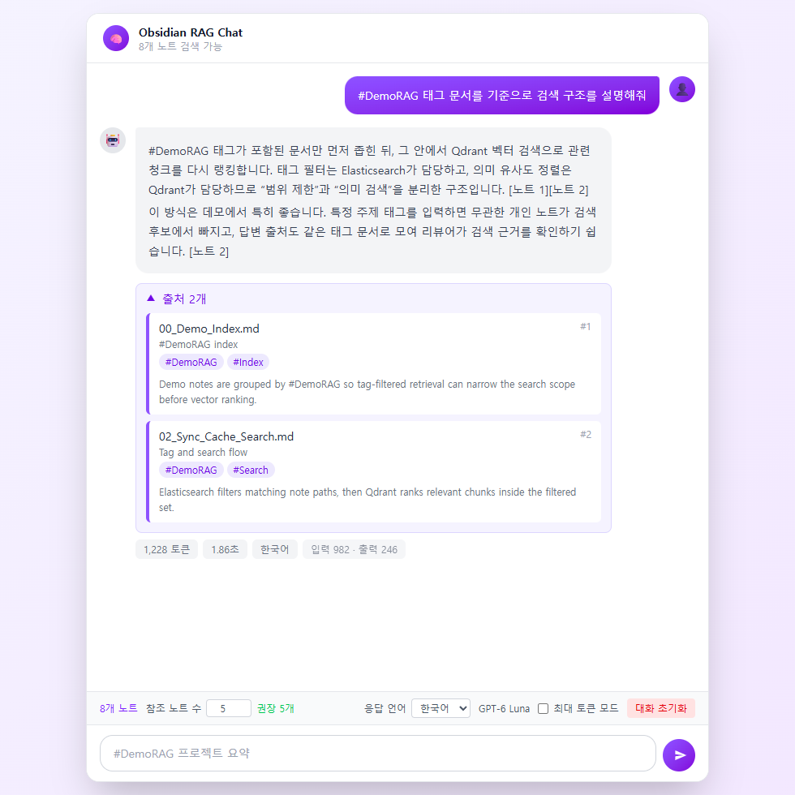
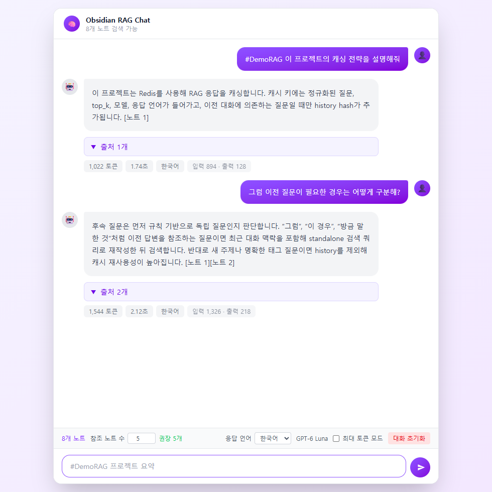

# Obsidian RAG Chat

Obsidian 노트를 RAG 검색 시스템으로 동기화하고, GPT와 대화하듯 질의할 수 있는 웹 인터페이스입니다.

[English](README.md) | [한국어](README_KO.md) | [日本語](README_日本語.md)

[](https://www.python.org/downloads/)
[](https://www.docker.com/)
[](https://fastapi.tiangolo.com/)

---

## 아키텍처


```text
사용자 브라우저 :3000
    |
    v
[nginx] React + Vite + TypeScript (frontend)
    |  SSE 프록시 -> /api/*
    v
[app.py] FastAPI (내부 :8000)
    |- 규칙 기반 독립 질문 / Follow-up 판별
    |- Redis 캐시 조회 -> 히트 시 즉시 반환 (TTL 30분)
    |
    v
[rag/generator.py]
    |- 후속 질문 -> 독립적으로 검색할 수 있는 질문으로 재작성
    |- 태그 추출 -> Elasticsearch 경로 필터
    |- 기본: Elasticsearch 키워드 검색 / 선택: Qdrant + 파일명 순위 결합(RRF)
    |- 내용이 같은 문서는 결과 한 자리로 병합, 다른 버전은 유지
    |- response_language 기반 한국어/영어/일본어 답변 제어
    |- 문서별 근거 청크 최대 4개 + 토큰 예산 내 주변 문맥
    |- gpt-6-luna -> Responses API의 텍스트 조각을 받는 즉시 SSE 전송
    |
    v
[sync_documents.py] 10분 주기 동기화
    |- MD5 해시 기반 변경 감지
    |- 헤더 기반 청킹 (512 토큰, 50 overlap)
    |- 선택: 파일명과 청크를 함께 임베딩해 Qdrant에 저장
    |- Elasticsearch 파일 단위 bulk index
```

임베딩 키가 없으면 검색과 동기화는 Elasticsearch만 사용합니다. Qdrant 연결이나 임베딩 호출이 필요하지 않습니다. 하이브리드 모드에서는 벡터 순위와 파일명·경로 매칭 순위를 RRF로 결합하며 태그 필터를 지원합니다. 질문에 명시한 폴더명도 범위 신호로 사용하지만 그 폴더로 검색을 제한하지는 않습니다. 본문 BM25와 벡터 순위의 결합은 아닙니다. 파일명 일치로 벡터 유사도를 덮어쓰지 않고, 문서별 토큰 예산 안에서 여러 근거 청크를 보존합니다. 후속 질문에는 재작성 결과와 직전 사용자 질문의 주제를 함께 사용합니다. 새 벡터 업로드 후 이전 벡터를 삭제하고 Qdrant와 Elasticsearch 상태를 독립적으로 확인해 부분 실패를 다음 동기화에서 재시도합니다.

---

## 기술 스택

| 역할 | 기술 |
|------|------|
| Frontend | React 19 + Vite 8.3.8 + TypeScript + Tailwind CSS v4 |
| Web Framework | FastAPI (Python 3.11+) |
| Vector DB | Qdrant (하이브리드 모드에서만 사용) |
| Full-text Search | Elasticsearch 8.19.26 |
| Cache | Redis 7.2.17 (TTL 30분) |
| LLM | `gpt-6-luna` (서버에서 고정, OpenAI Responses API) |
| Embedding | text-embedding-3-small (1536 dim, 파일명 prefix 포함) |
| Container | Docker + Docker Compose |

---

## 데모

공개용 합성 노트로 만든 하이브리드 검색·후속 질문·캐시 히트 예시입니다. 답변과 표시된 시간·사용량은 화면 흐름을 설명하기 위한 값이며, 실제 모델 응답이나 성능 측정 결과가 아닙니다.

### 시작 화면



### 답변 화면


### 태그 검색 답변



### 팔로우업 답변



### 캐시 히트


`http://127.0.0.1:3000?lang=ko`에서 한국어 시작 화면을 엽니다. 주소 뒤에 `&demo=answer`, `&demo=tag`, `&demo=followup`, `&demo=cache`를 붙이면 해당 예시 대화를 볼 수 있습니다.

---

## 빠른 시작

### 1. 저장소 클론

```bash
git clone https://github.com/wonhongChang/ObsidianRagChat.git
cd ObsidianRagChat
```

### 2. 환경 변수 설정

[환경 변수 예시](.env.example)를 바탕으로 로컬 `.env`를 만드세요. 인덱싱할 권한이 있는 보관함의 절대 경로를 지정합니다.

```bash
# 필수
OPENAI_API_KEY=
OBSIDIAN_VAULT_PATH=/path/to/your/obsidian/vault

# 선택: 비워 두면 Elasticsearch 키워드 검색만 사용
OPENAI_EMBEDDING_API_KEY=
# 같은 키에 임베딩 권한이 있고 재사용하려면 위 한 줄을 다음으로 교체
# OPENAI_EMBEDDING_API_KEY=${OPENAI_API_KEY}
QDRANT_URL=
QDRANT_API_KEY=
```

### 3. 실행

앱은 `OPENAI_API_KEY`를 답변 생성과 후속 질문 재작성에 사용합니다. `OPENAI_EMBEDDING_API_KEY`가 비어 있으면 키워드 검색만 사용하며 생성용 키를 임베딩에 자동으로 쓰지 않습니다. 하이브리드 검색을 쓰려면 Qdrant 연결을 설정하고, 임베딩 권한이 있는 전용 키를 지정하거나 위 예시처럼 같은 키를 명시적으로 참조하세요. 기존 `text-embedding-3-small` 1536차원 벡터는 다시 만들 필요가 없습니다. 누락되거나 바뀐 노트는 다음 동기화 때 반영됩니다.

```bash
docker compose up -d --build

# 로그 확인
docker compose logs -f web
docker compose logs -f sync
```

### 4. 접속

```text
http://127.0.0.1:3000
```

기본 Compose 설정에서 UI·API 프록시는 `127.0.0.1:3000`, Elasticsearch는 `127.0.0.1:9201`, Redis는 `127.0.0.1:6379`로만 공개됩니다. 컨테이너끼리는 `elasticsearch:9200`, `redis:6379`를 사용합니다. 기존 배포는 해당 서비스를 다시 생성해야 새 포트 설정이 적용됩니다. DB 업그레이드 전에는 데이터를 먼저 백업하세요. 로컬 연결 제한은 인증이 아닙니다. 인증과 보관함별 접근 제어 없이 터널·공개 프록시·LAN으로 노출하지 마세요.

캐시에 없는 답변을 생성할 때 질문과 선택된 노트 발췌문이 OpenAI로 전송되며, 후속 질문 재작성에는 관련 대화 기록도 사용될 수 있습니다. 키워드 검색 모드에서도 이 호출은 과금될 수 있습니다. 하이브리드 모드는 노트 청크와 질의를 임베딩 API에도 보내고, 벡터와 노트 데이터를 지정한 Qdrant에 저장합니다. 동기화 전에 사용할 보관함을 확인하세요.

---

## 사용 예시

### 일반 질문

```text
"Obsidian RAG Chat의 동기화 방식 알려줘"
```

노트를 검색한 뒤 관련 근거를 모아 답합니다. 기본 모드는 키워드 검색이며, 임베딩을 설정하면 벡터 검색도 사용합니다.

### 태그 필터

```text
"#RagChat 태그 문서를 요약해줘"
```

두 모드 모두 Elasticsearch를 통해 해당 태그의 노트로 검색 범위를 좁힙니다.

### Follow-up 질문

```text
질문1: "Redis 캐싱 전략 설명해줘"
질문2: "그럼 TTL은 어떻게 정해?"
```

후속 질문은 최근 대화 히스토리를 참고해 standalone 검색 쿼리로 재작성한 뒤 검색합니다.

### 다국어 응답

```text
응답 언어: Auto / 한국어 / English / 日本語
```

노트 원문은 UTF-8 Markdown 그대로 수집하며, 하이브리드 모드에서는 모든 언어에 같은 임베딩 모델을 사용합니다. `response_language`는 검색 결과를 번역하지 않고 생성 단계에서 답변 언어를 정합니다. 캐시 키에도 포함되어 같은 질문의 한국어/영어/일본어 답변이 섞이지 않습니다.

---

## API

| Method | Endpoint | 설명 |
|--------|----------|------|
| `POST` | `/api/search` | RAG 검색 후 전체 답변 반환 |
| `POST` | `/api/search/stream` | 캐시 미스 시 Responses API에서 생성 중인 텍스트를 SSE로 전달, 히트 시 저장된 답변 반환 |
| `DELETE` | `/api/cache` | RAG 응답 캐시 삭제 |
| `GET` | `/api/cache/stats` | Redis 캐시 통계 |
| `GET` | `/api/notes/count` | 인덱싱된 노트 수 |
| `GET` | `/health` | 헬스 체크 |

### `POST /api/search` 요청 예시

```json
{
  "query": "질문 내용",
  "top_k": 5,
  "response_language": "auto",
  "ignore_token_limit": false,
  "history": []
}
```

---

## 프로젝트 구조

```text
ObsidianRagChat/
|- app.py                    # FastAPI 서버, 캐시, 질문 판별 라우팅
|- sync_documents.py         # 증분 동기화 배치
|- frontend/                 # React + Vite + TypeScript UI
|  |- src/api/stream.ts      # SSE async generator
|  |- src/components/        # Chat UI 컴포넌트
|  |- src/hooks/useChat.ts   # Zustand 상태 관리
|  |- nginx.conf             # SSE 프록시 설정
|- embed/
|  |- chunker.py             # 헤더 기반 청킹
|  |- document_loader.py     # Obsidian Markdown 로더
|  |- embedder.py            # OpenAI 임베딩 배치 처리
|  |- vector_store.py        # Qdrant 클라이언트
|- rag/
|  |- generator.py           # 검색, 컨텍스트 구성, GPT 호출
|  |- context.py             # 검색 근거를 우선하는 컨텍스트 구성
|  |- retrieval.py           # 순위 결합과 근거 청크 병합
|- search/
|  |- cache.py               # Redis 캐시
|  |- document_index.py      # Elasticsearch 인덱싱
|  |- question_detector.py   # 독립 질문 / Follow-up 규칙 판별
|- scripts/
|  |- clear_cache.py         # Redis 캐시 초기화
|  |- clear_qdrant.py        # Qdrant 컬렉션 초기화
|  |- add_qdrant_index.py    # Qdrant payload index 추가
|  |- evaluate_rag.py        # 합성 데이터 컨텍스트 / 벡터 검색 평가
|- tests/
|  |- test_chunker.py
|  |- test_question_detector.py
|  |- test_context.py        # 전체 답변 경로의 근거 전달
|  |- test_sync.py           # 부분 실패와 재시도
|  |- test_cache.py          # 캐시 장애와 키 분리
|  |- test_indexing.py       # 원본 / 인덱스 오류 처리
|  |- test_evaluation.py     # 평가 데이터와 지표
|  |- EVALUATION.md          # 평가 방법, 결과, 한계
|- docker-compose.yml
|- Dockerfile.frontend
|- Dockerfile.web
|- Dockerfile.sync
|- requirements.txt
```

---

## 주요 명령

```bash
# 비밀값을 출력하지 않고 앱 상태와 검색 모드 확인
curl http://127.0.0.1:3000/health

# 앱·키 변경을 실행 중인 스택에 반영 (DB 서비스와 볼륨 유지)
docker compose up -d --build --no-deps web frontend sync

# 저장소 루트의 로컬 가상환경에서 합성 데이터만 평가 (유료 호출 없음)
python -m scripts.evaluate_rag
```

검색 결과가 없다면 보관함 마운트, 검색 모드, 최근 동기화 오류부터 확인하세요. 변경된 노트는 다음 동기화에서 재시도합니다. 일반적인 업데이트나 문제 확인을 위해 인덱스를 삭제할 필요는 없습니다.

---

## 검증

테스트는 실행용 web 이미지가 아닌 저장소 루트의 Python 3.11 가상환경에서 실행합니다.

```bash
python -m pip install -r requirements-dev.txt
python -m pytest tests -q
```

회귀 테스트는 검색 근거 전달, 인덱싱 재시도, 캐시 장애를 검증합니다. 합성 노트 10개와 한·영·일 질문 30개에서 정답 청크를 제공한 근거 보존 검사는 10/30에서 30/30으로 개선됐습니다. Recall@5 = 1.000, MRR@5 = 0.907은 이전에 측정한 벡터 검색 단독 결과이며, 현재 키워드 검색이나 `gpt-6-luna` 답변을 평가한 수치가 아닙니다.

이는 작은 합성 데이터의 결과이며 **실서비스 답변 정확도를 뜻하지 않습니다**. [실행 명령, 평가 방법과 한계](tests/EVALUATION.md)를 함께 확인하세요. 실제 앱 전체 검색 흐름과 생성 답변은 실제 사용 질문으로 별도 평가해야 합니다. 개인용 실행을 전제로 하며, 다중 사용자 공개 배포에는 인증과 접근 제어가 필요합니다.

---

## 보안

- `.env` 파일은 커밋하지 마세요. `.gitignore`에 포함되어 있습니다.
- API 키는 서버에만 두세요. `.env` 내용이나 키 값이 포함될 수 있는 Compose 설정 출력을 공유하지 마세요.
- 개인 Obsidian vault 경로와 노트 원문이 로그에 과도하게 남지 않도록 운영 환경에서는 로그 레벨을 조정하는 것을 권장합니다.
