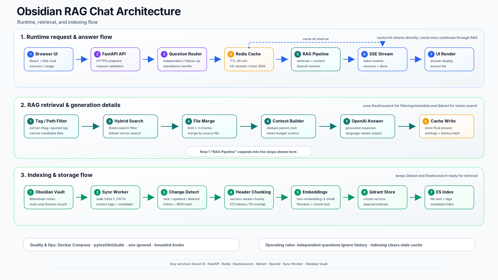
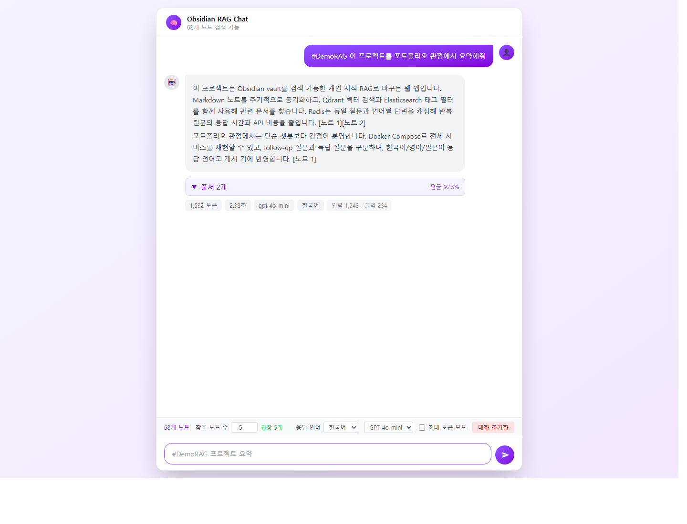
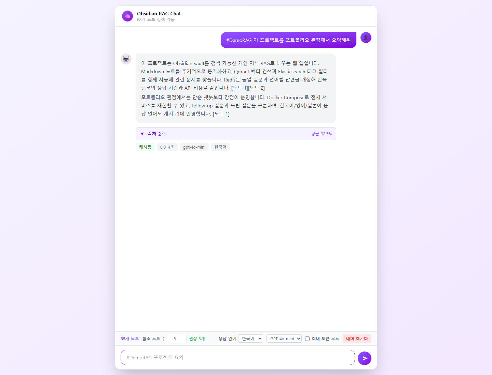

# Obsidian RAG Chat

Obsidian 노트를 RAG 검색 시스템으로 동기화하고, GPT와 대화하듯 질의할 수 있는 웹 인터페이스입니다.

[English](README.md) | [한국어](README_KO.md) | [日本語](README_日本語.md)

[](https://www.python.org/downloads/)
[](https://www.docker.com/)
[](https://fastapi.tiangolo.com/)

---

## 아키텍처



```text
사용자 브라우저 :3000
    |
    v
[nginx] React + Vite + TypeScript (frontend)
    |  SSE 프록시 -> /api/*
    v
[app.py] FastAPI (내부 :8000)
    |- 규칙 기반 독립 질문 / Follow-up 판별
    |- Redis 캐시 조회 -> 히트 시 즉시 반환 (TTL 30분)
    |
    v
[rag/generator.py]
    |- Follow-up 질문 -> GPT standalone rewrite -> 벡터 검색
    |- 태그 추출 -> Elasticsearch 경로 필터
    |- Qdrant 청크 벡터 검색 -> 파일 단위 병합 -> top-k
    |- 파일명 키워드 매칭 보강 (한국어/일본어/CJK 대응)
    |- response_language 기반 한국어/영어/일본어 답변 제어
    |- parent_text 기반 컨텍스트 구성 (기본 max 110K 토큰)
    |- GPT 답변 생성 및 SSE 스트리밍
    |
    v
[sync_documents.py] 10분 주기 동기화
    |- MD5 해시 기반 변경 감지
    |- 헤더 기반 청킹 (512 토큰, 50 overlap)
    |- "파일명: {name}\n{text}" 형식으로 임베딩
    |- Qdrant 100청크 단위 upsert
    |- Elasticsearch 파일 단위 bulk index
```

---

## 기술 스택

| 역할 | 기술 |
|------|------|
| Frontend | React 19 + Vite + TypeScript + Tailwind CSS v4 |
| Web Framework | FastAPI (Python 3.11+) |
| Vector DB | Qdrant Cloud |
| Full-text Search | Elasticsearch 8.18 |
| Cache | Redis 7.2 (TTL 30분) |
| LLM | GPT-4o-mini / GPT-5-mini |
| Embedding | text-embedding-3-small (1536 dim, 파일명 prefix 포함) |
| Container | Docker + Docker Compose |

---

## 데모

### 시작 화면


### 답변 화면



### 태그 검색 답변


### 팔로우업 답변


### 캐시 히트



데모 노트에는 `#DemoRAG` 태그를 붙여 태그 검색, 다국어 질의, 캐시 히트, Follow-up 흐름을 빠르게 확인할 수 있습니다. 한국어 스크린샷 재촬영 시 `http://localhost:3000?lang=ko`로 초기 응답 언어를 고정할 수 있고, `&demo=answer`, `&demo=tag`, `&demo=followup`, `&demo=cache`를 붙이면 각 데모 화면을 안정적으로 캡처할 수 있습니다. 영어와 일본어 스크린샷은 각 언어 README에서 따로 관리합니다.

---

## 빠른 시작

### 1. 저장소 클론

```bash
git clone https://github.com/wonhongChang/ObsidianRagChat.git
cd ObsidianRagChat
```

### 2. 환경 변수 설정

`.env` 파일을 만들고 아래 값을 채웁니다.

```bash
# 필수
OPENAI_API_KEY=your_openai_api_key_here
QDRANT_URL=https://your-cluster.cloud.qdrant.io:6333
QDRANT_API_KEY=replace_me
OBSIDIAN_VAULT_PATH=/path/to/your/obsidian/vault

# Docker 내부 서비스 (기본값 그대로 사용 가능)
ELASTICSEARCH_HOST=http://elasticsearch:9200
REDIS_HOST=redis
REDIS_PORT=6379

# 선택
CACHE_TTL=1800
INTERVAL_SECONDS=600
```

### 3. 실행

```bash
docker-compose up -d

# 로그 확인
docker-compose logs -f web
docker-compose logs -f sync
```

### 4. 접속

```text
http://localhost:3000
```

---

## 사용 예시

### 일반 질문

```text
"Obsidian RAG Chat의 동기화 방식 알려줘"
```

전체 노트에서 관련 청크를 벡터 검색하고, 파일 단위로 병합한 뒤 답변합니다.

### 태그 필터

```text
"#RagChat 태그 문서를 요약해줘"
```

Elasticsearch로 태그가 일치하는 문서 경로를 먼저 좁힌 뒤 Qdrant 벡터 검색을 수행합니다.

### Follow-up 질문

```text
질문1: "Redis 캐싱 전략 설명해줘"
질문2: "그럼 TTL은 어떻게 정해?"
```

후속 질문은 최근 대화 히스토리를 참고해 standalone 검색 쿼리로 재작성한 뒤 검색합니다.

### 다국어 응답

```text
응답 언어: Auto / 한국어 / English / 日本語
```

노트 원문은 UTF-8 Markdown 그대로 수집하고 `text-embedding-3-small`로 같은 벡터 공간에 임베딩합니다. `response_language`는 검색 결과를 바꾸는 번역 옵션이 아니라, 생성 단계에서 답변 언어를 제어하는 옵션입니다. 캐시 키에도 포함되어 같은 질문의 한국어/영어/일본어 답변이 섞이지 않습니다.

---

## API

| Method | Endpoint | 설명 |
|--------|----------|------|
| `POST` | `/api/search` | RAG 검색 후 전체 답변 반환 |
| `POST` | `/api/search/stream` | RAG 검색 후 SSE 스트리밍 |
| `DELETE` | `/api/cache` | Redis 캐시 전체 삭제 |
| `GET` | `/api/cache/stats` | Redis 캐시 통계 |
| `GET` | `/api/notes/count` | 인덱싱된 노트 수 |
| `GET` | `/health` | 헬스 체크 |

### `POST /api/search` 요청 예시

```json
{
  "query": "질문 내용",
  "top_k": 5,
  "model": "gpt-4o-mini",
  "response_language": "auto",
  "ignore_token_limit": false,
  "history": []
}
```

---

## 프로젝트 구조

```text
ObsidianRagChat/
|- app.py                    # FastAPI 서버, 캐시, 질문 판별 라우팅
|- sync_documents.py         # 증분 동기화 배치
|- frontend/                 # React + Vite + TypeScript UI
|  |- src/api/stream.ts      # SSE async generator
|  |- src/components/        # Chat UI 컴포넌트
|  |- src/hooks/useChat.ts   # Zustand 상태 관리
|  |- nginx.conf             # SSE 프록시 설정
|- embed/
|  |- chunker.py             # 헤더 기반 청킹
|  |- document_loader.py     # Obsidian Markdown 로더
|  |- embedder.py            # OpenAI 임베딩 배치 처리
|  |- vector_store.py        # Qdrant 클라이언트
|- rag/
|  |- generator.py           # 검색, 컨텍스트 구성, GPT 호출
|- search/
|  |- cache.py               # Redis 캐시
|  |- document_index.py      # Elasticsearch 인덱싱
|  |- question_detector.py   # 독립 질문 / Follow-up 규칙 판별
|- scripts/
|  |- clear_cache.py         # Redis 캐시 초기화
|  |- clear_qdrant.py        # Qdrant 컬렉션 초기화
|  |- add_qdrant_index.py    # Qdrant payload index 추가
|- tests/
|  |- test_question_detector.py
|- docker-compose.yml
|- Dockerfile.frontend
|- Dockerfile.web
|- Dockerfile.sync
|- requirements.txt
```

---

## 주요 명령

```bash
# Redis 캐시 초기화
docker-compose exec web python scripts/clear_cache.py
curl -X DELETE http://localhost:3000/api/cache

# Qdrant 컬렉션 초기화 후 재동기화
docker-compose exec web python scripts/clear_qdrant.py
docker-compose restart sync

# Elasticsearch 인덱스 재생성
curl -X DELETE http://localhost:9201/obsidian_notes
docker-compose restart sync

# 프론트엔드 재빌드
docker-compose up -d --build --force-recreate frontend

# 테스트
docker-compose exec web python -m pytest tests/ -v
```

---

## 트러블슈팅

### 검색 결과가 없을 때

```bash
curl http://localhost:9201/_cluster/health
curl http://localhost:3000/api/notes/count
docker-compose logs -f sync
```

### 태그 필터 결과가 이상할 때

Elasticsearch 인덱스 mapping 변경은 기존 인덱스에 소급 적용되지 않습니다. 인덱스를 삭제하고 `sync` 서비스를 다시 시작하세요.

```bash
curl -X DELETE http://localhost:9201/obsidian_notes
docker-compose restart sync
```

### 답변이 느릴 때

- `top_k` 값을 낮춥니다.
- `ignore_token_limit` 옵션을 끕니다.
- `rag_query.log`에서 검색/컨텍스트 구성 시간을 확인합니다.

---

## 보안

- `.env` 파일은 커밋하지 마세요. `.gitignore`에 포함되어 있습니다.
- `OPENAI_API_KEY`, `QDRANT_API_KEY`는 외부에 노출하지 마세요.
- 개인 Obsidian vault 경로와 노트 원문이 로그에 과도하게 남지 않도록 운영 환경에서는 로그 레벨을 조정하는 것을 권장합니다.
