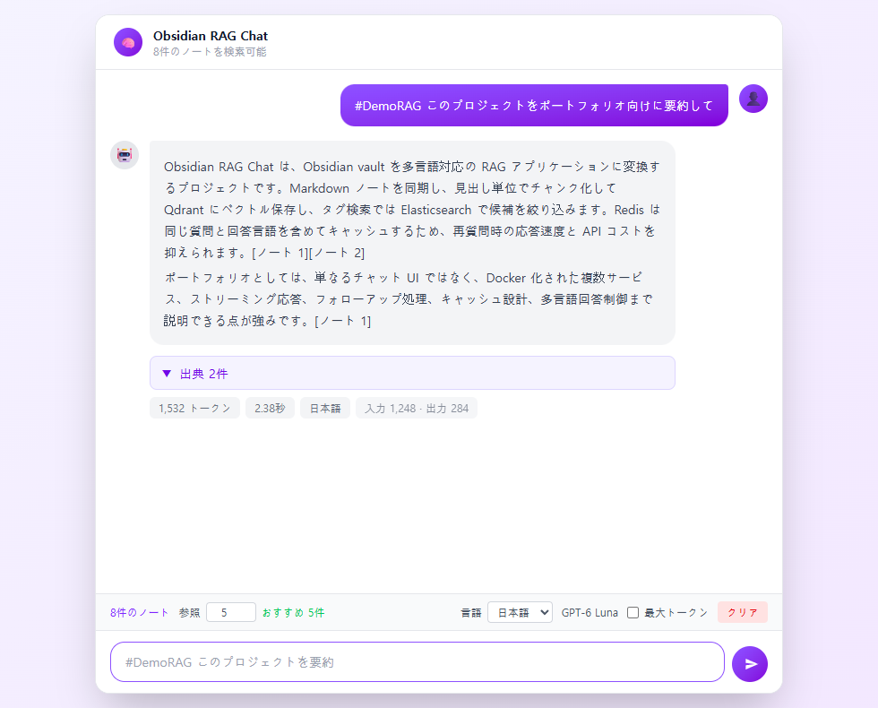
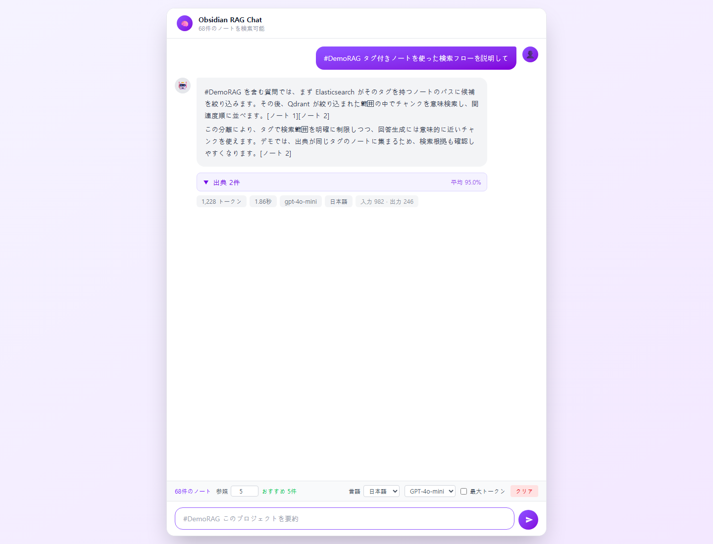
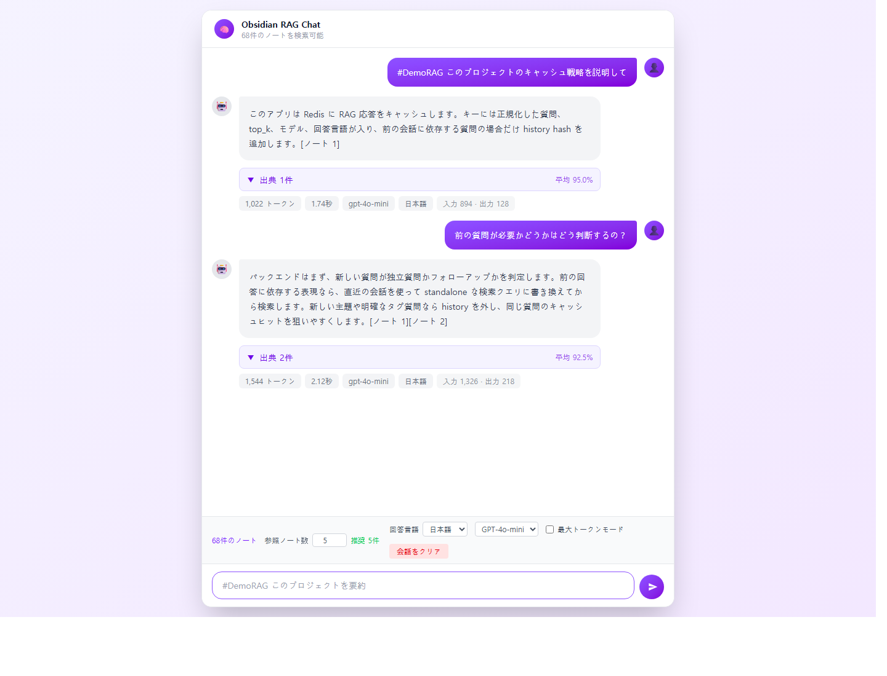

# Obsidian RAG Chat

ObsidianノートをRAGシステムに変換してGPTと対話するWebインターフェース。

[English](README.md) | [한국어](README_KO.md) | [日本語](README_日本語.md)

[](https://www.python.org/downloads/)
[](https://www.docker.com/)
[](https://fastapi.tiangolo.com/)

---

## アーキテクチャ


```
ユーザーブラウザ :3000
    │
    ▼
[nginx] React + Vite + TypeScript (frontend)
    │  SSEプロキシ → /api/*
    ▼
[app.py] FastAPI (内部 :8000)
    ├─ ルールベース 独立/フォローアップ判定 (包含関係・類似度・#タグ等)
    ├─ Redisキャッシュ確認 → ヒット時は即座に返却 (TTL 30分)
    │
    ▼ (ミス時)
[rag/generator.py]
    ├─ フォローアップ → GPT standalone rewrite → ベクトル検索
    ├─ タグ抽出 → Elasticsearch パスフィルタ (大文字・小文字両対応)
    ├─ Qdrant チャンクベクトル検索 (limit × 3 → ファイル単位マージ → top-k)
    ├─ ファイル名キーワードマッチング → スコアブースト (日本語/CJK対応)
    ├─ response_language による韓国語/英語/日本語の回答制御
    ├─ parent_text ベースのコンテキスト構成 (max 110K トークン)
    └─ GPT回答生成 → SSEストリーミング (初回トークン ~1秒以内)
    │
    ▼
[sync_documents.py] 10分周期
    ├─ MD5ハッシュベース変更検出
    ├─ ヘッダーベースチャンキング (512トークン、50 overlap)
    ├─ "ファイル名: {name}\n{text}" 形式で埋め込み (ファイル名の意味を反映)
    ├─ Qdrant 100チャンクバッチ upsert
    └─ Elasticsearch ファイル単位 bulk index
```

---

## 技術スタック

| 役割 | 技術 |
|------|------|
| Frontend | React 19 + Vite + TypeScript + Tailwind CSS v4 |
| Web Framework | FastAPI (Python 3.11+) |
| Vector DB | Qdrant Cloud |
| Full-text Search | Elasticsearch 8.18 |
| Cache | Redis 7.2 (TTL 30分) |
| LLM | GPT-4o-mini / GPT-5-mini (設定可能) |
| Embedding | text-embedding-3-small (1536dim、ファイル名prefix含む) |
| Container | Docker + Docker Compose |

---

## デモ

### スタート画面


### 回答画面



### タグ検索回答



### フォローアップ回答



### キャッシュヒット


デモ用ノートには `#DemoRAG` タグを付けています。タグ検索、多言語回答、同一質問のキャッシュヒット、フォローアップ質問の流れをすぐ確認できます。日本語スクリーンショットを再撮影する場合は `http://localhost:3000?lang=ja` で初期応答言語を固定でき、`&demo=answer`、`&demo=tag`、`&demo=followup`、`&demo=cache` を付けると各デモ画面を安定して撮影できます。韓国語と英語のスクリーンショットは各言語 README で別々に管理します。

---

## クイックスタート

### 1. リポジトリのクローン

```bash
git clone https://github.com/wonhongChang/ObsidianRagChat.git
cd ObsidianRagChat
```

### 2. 環境変数の設定

`.env` ファイルを作成：

```bash
# 必須
OPENAI_API_KEY=your_openai_api_key_here
QDRANT_URL=https://your-cluster.cloud.qdrant.io:6333
QDRANT_API_KEY=replace_me
OBSIDIAN_VAULT_PATH=/path/to/your/obsidian/vault

# Docker内部サービス (変更不要)
ELASTICSEARCH_HOST=http://elasticsearch:9200
REDIS_HOST=redis
REDIS_PORT=6379

# オプション
CACHE_TTL=1800        # Redis TTL (秒、デフォルト30分)
INTERVAL_SECONDS=600  # 同期間隔 (秒、デフォルト10分)
```

### 3. 実行

```bash
docker-compose up -d

# ログ確認
docker-compose logs -f web
docker-compose logs -f sync
```

### 4. アクセス

```
http://localhost:3000
```

---

## 使用方法

#### 一般的な質問
```
"Obsidian RAG Chatの同期方法を教えて"
→ 全ノートのベクトル検索 (デフォルト top_k=5)
```

#### タグフィルター
```
"#RagChat タグの文書を要約して"
→ RagChat タグの文書のみ検索
```

#### フォローアップ
```
質問1: "Redisのキャッシュ戦略を説明して"
質問2: "じゃあTTLはどう設定する？"
→ 会話履歴をもとに standalone rewrite してから検索
```

#### 多言語回答
```
応答言語: Auto / 한국어 / English / 日本語
```

Obsidian Markdown は UTF-8 の原文のまま収集し、`text-embedding-3-small` で同じベクトル空間に埋め込みます。`response_language` は検索結果を翻訳する設定ではなく、生成段階で回答言語を制御する設定です。Redis のキャッシュキーにも含めるため、同じ質問の韓国語/英語/日本語回答が混ざりません。

---

## API

| Method | Endpoint | 説明 |
|--------|----------|------|
| `POST` | `/api/search` | RAG検索 (全体レスポンス返却) |
| `POST` | `/api/search/stream` | RAG検索 SSEストリーミング |
| `DELETE` | `/api/cache` | キャッシュ全削除 |
| `GET` | `/api/cache/stats` | キャッシュ統計 |
| `GET` | `/api/notes/count` | 全ノート数 |
| `GET` | `/health` | ヘルスチェック |

**POST /api/search リクエストパラメータ：**

```json
{
  "query": "質問内容",
  "top_k": 5,
  "model": "gpt-4o-mini",
  "response_language": "auto",
  "ignore_token_limit": false,
  "history": []
}
```

---

## プロジェクト構造

```
ObsidianRagChat/
├── app.py                     # FastAPIサーバー、キャッシュ/質問判定ルーティング
├── sync_documents.py          # 増分同期 (ハッシュベース)
│
├── frontend/                  # React + Vite + TypeScript UI
│   ├── src/
│   │   ├── api/stream.ts      # SSE async generator
│   │   ├── components/        # ChatMessage, ChatInput, SettingsBar 等
│   │   ├── hooks/useChat.ts   # Zustand 状態管理
│   │   └── types/index.ts
│   ├── nginx.conf             # SSEプロキシ + Docker DNS resolver
│   └── package.json
│
├── embed/
│   ├── chunker.py             # ヘッダーベースチャンキング + スライディングウィンドウ
│   ├── embedder.py            # OpenAI埋め込み (バッチインデックス安全処理)
│   ├── document_loader.py     # マークダウンローダー
│   └── vector_store.py        # Qdrantクライアント
│
├── rag/
│   └── generator.py           # 検索 + コンテキスト構成 + GPT呼び出し
│
├── search/
│   ├── document_index.py      # Elasticsearch (lowercase_normalizer)
│   ├── cache.py               # Redisキャッシング + クエリ正規化
│   └── question_detector.py   # 独立/フォローアップ判定 (ルールベース)
│
├── scripts/
│   ├── clear_cache.py         # Redis キャッシュ初期化
│   ├── clear_qdrant.py        # Qdrant コレクション初期化
│   └── add_qdrant_index.py    # path フィールドインデックス追加 (初回のみ)
│
├── tests/
│   ├── test_question_detector.py  # 質問判定ユニットテスト (24件)
│   └── README.md
│
├── docker-compose.yml
├── Dockerfile.frontend
├── Dockerfile.web
├── Dockerfile.sync
└── requirements.txt
```

---

## 主要コマンド

```bash
# キャッシュ初期化
docker-compose exec web python scripts/clear_cache.py
curl -X DELETE http://localhost:3000/api/cache

# Qdrant初期化 (再同期が必要な場合)
docker-compose exec web python scripts/clear_qdrant.py
docker-compose restart sync

# ESインデックス再作成 (lowercase_normalizer適用)
curl -X DELETE http://localhost:9201/obsidian_notes
docker-compose restart sync

# テスト
docker-compose exec web python -m pytest tests/ -v

# フロントエンド更新後の再ビルド
docker-compose up -d --build --force-recreate frontend
```

---

## トラブルシューティング

**検索結果なし**
```bash
curl http://localhost:9201/_cluster/health
curl http://localhost:3000/api/notes/count
```

**タグフィルターが効かない** — ESインデックスの再作成が必要 (上記コマンド参照)

**応答が遅い** — `rag_query.log` でボトルネック確認、top_k を減らす

**Dockerビルド失敗**
```bash
docker-compose build --no-cache
docker-compose down -v && docker-compose up -d
```

---

## セキュリティ

- `.env` ファイルは絶対にコミットしないでください (`.gitignore` に含まれています)
- `OPENAI_API_KEY`、`QDRANT_API_KEY` の外部公開禁止
