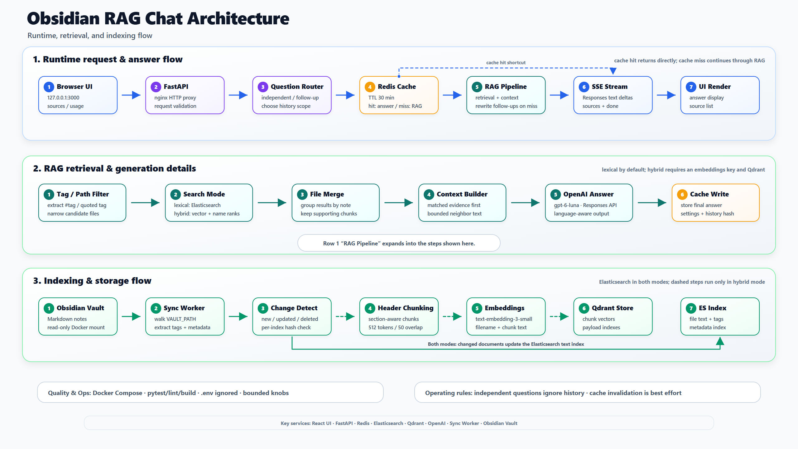
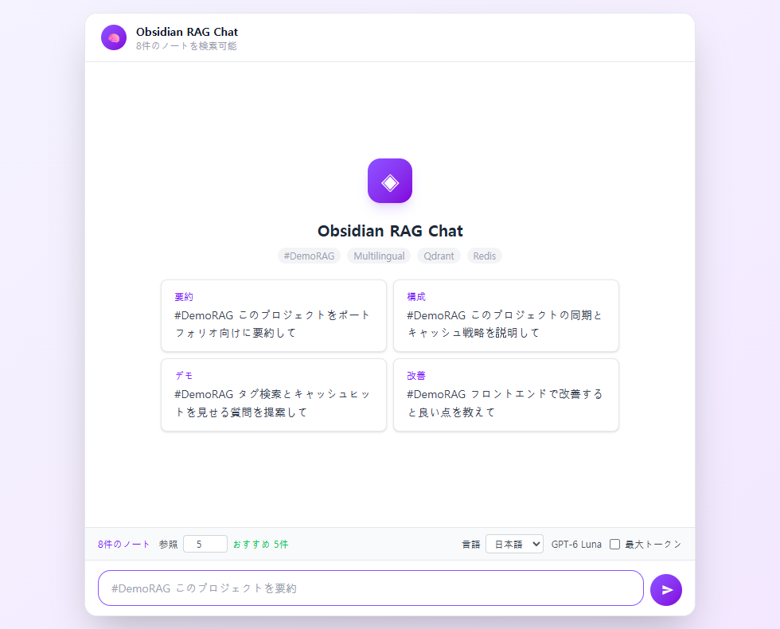
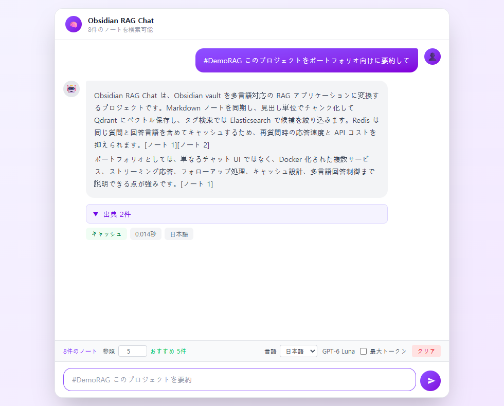

# Obsidian RAG Chat

ObsidianノートをRAGシステムに変換してGPTと対話するWebインターフェース。

[English](README.md) | [한국어](README_KO.md) | [日本語](README_日本語.md)

[](https://www.python.org/downloads/)
[](https://www.docker.com/)
[](https://fastapi.tiangolo.com/)

---

## アーキテクチャ



```
ユーザーブラウザ :3000
    │
    ▼
[nginx] React + Vite + TypeScript (frontend)
    │  SSEプロキシ → /api/*
    ▼
[app.py] FastAPI (内部 :8000)
    ├─ ルールベース 独立/フォローアップ判定 (包含関係・類似度・#タグ等)
    ├─ Redisキャッシュ確認 → ヒット時は即座に返却 (TTL 30分)
    │
    ▼ (ミス時)
[rag/generator.py]
    ├─ フォローアップ → 単独で検索できる質問に書き換え
    ├─ タグ抽出 → Elasticsearch パスフィルタ (大文字・小文字両対応)
    ├─ 既定: Elasticsearch キーワード検索 / 任意: Qdrant + ファイル名の順位を RRF で統合
    ├─ 内容が同一の文書は1枠に統合、異なる版は保持
    ├─ response_language による韓国語/英語/日本語の回答制御
    ├─ 文書ごとに最大4件の根拠チャンク + トークン予算内の周辺文脈
    └─ gpt-6-luna → Responses API の生成中のテキストを SSE で順次配信
    │
    ▼
[sync_documents.py] 10分周期
    ├─ MD5ハッシュベース変更検出
    ├─ ヘッダーベースチャンキング (512トークン、50 overlap)
    ├─ 任意: ファイル名を含むチャンクをベクトル化して Qdrant に保存
    └─ Elasticsearch ファイル単位 bulk index
```

---

埋め込み用のキーを設定しない場合は、検索と同期に Elasticsearch のみを使います。Qdrant への接続も埋め込み API の呼び出しも不要です。ハイブリッドモードではベクトル順位とファイル名・パス一致順位を RRF で統合し、タグフィルターにも対応します。質問に明示されたフォルダー名も範囲の手掛かりにしますが、そのフォルダーだけに検索を限定しません。全文 BM25 とベクトル順位の融合ではありません。ファイル名一致でベクトル類似度を上書きせず、文書ごとのトークン予算内で複数の根拠チャンクを保持します。追加質問には書き換え結果と直前のユーザー質問の主題を併用します。新しいベクトルの登録後に古いものを削除し、Qdrant と Elasticsearch を個別に照合して、部分的な失敗を次の同期で再試行します。

## 技術スタック

| 役割 | 技術 |
|------|------|
| Frontend | React 19 + Vite 8.3.8 + TypeScript + Tailwind CSS v4 |
| Web Framework | FastAPI (Python 3.11+) |
| Vector DB | Qdrant（ハイブリッドモードのみ） |
| Full-text Search | Elasticsearch 8.19.26 |
| Cache | Redis 7.2.17 (TTL 30分) |
| LLM | `gpt-6-luna`（サーバー側で固定、OpenAI Responses API） |
| Embedding | text-embedding-3-small (1536dim、ファイル名prefix含む) |
| Container | Docker + Docker Compose |

---

## デモ

公開用の合成ノートを使った、ハイブリッド検索・追加質問・キャッシュヒットの画面例です。回答・処理時間・トークン使用量は説明用の値で、実際のモデル出力や計測結果ではありません。

### スタート画面



### 回答画面


### タグ検索回答


### フォローアップ回答


### キャッシュヒット



`http://127.0.0.1:3000?lang=ja` を開くと日本語の初期画面が表示されます。URL の末尾に `&demo=answer`、`&demo=tag`、`&demo=followup`、`&demo=cache` を追加すると、それぞれのサンプル会話を確認できます。

---

## クイックスタート

### 1. リポジトリのクローン

```bash
git clone https://github.com/wonhongChang/ObsidianRagChat.git
cd ObsidianRagChat
```

### 2. 環境変数の設定

[環境変数の設定例](.env.example)を参考に、ローカルの `.env` を作成します。インデックスを作成する権限のある保管庫の絶対パスを指定してください。

```bash
# 必須
OPENAI_API_KEY=
OBSIDIAN_VAULT_PATH=/path/to/your/obsidian/vault

# 任意: 空欄の場合は Elasticsearch のキーワード検索のみ
OPENAI_EMBEDDING_API_KEY=
# 埋め込み権限を持つ同じキーを使う場合は、上の行を次の設定に置き換える
# OPENAI_EMBEDDING_API_KEY=${OPENAI_API_KEY}
QDRANT_URL=
QDRANT_API_KEY=
```

### 3. 実行

アプリは `OPENAI_API_KEY` を回答生成と追加質問の書き換えに使います。`OPENAI_EMBEDDING_API_KEY` が空欄ならキーワード検索のみとなり、生成用キーを埋め込みに自動で流用することはありません。ハイブリッド検索では Qdrant の接続先を設定し、埋め込み権限のある専用キーを指定するか、上の例のように同じキーを明示的に参照してください。既存の `text-embedding-3-small` の1536次元ベクトルはそのまま使えます。追加・変更されたノートは次の同期で反映します。

```bash
docker compose up -d --build

# ログ確認
docker compose logs -f web
docker compose logs -f sync
```

### 4. アクセス

```
http://127.0.0.1:3000
```

Compose の既定では UI と API プロキシは `127.0.0.1:3000`、Elasticsearch は `127.0.0.1:9201`、Redis は `127.0.0.1:6379` でのみ公開されます。コンテナ間の接続先は `elasticsearch:9200` と `redis:6379` です。既存の環境でポート設定を反映するには対象サービスの再作成が必要です。データベースの更新前にバックアップを取ってください。ループバックへの制限は認証ではありません。認証と保管庫ごとのアクセス制御なしにトンネル・公開プロキシ・LAN 経由で公開しないでください。

キャッシュにない回答を生成すると、質問と関連ノートの抜粋が OpenAI に送信されます。追加質問の書き換えでは、関連する会話履歴も使われることがあります。キーワード検索でも、この生成処理は課金対象になり得ます。ハイブリッドモードでは、ノートのチャンクと質問を埋め込み API にも送り、ベクトルとノートのデータを指定した Qdrant に保存します。同期の前に対象の保管庫を確認してください。

---

## 使用方法

#### 一般的な質問
```
"Obsidian RAG Chatの同期方法を教えて"
→ ノートを検索して回答（既定はキーワード検索、最大5件）
```

#### タグフィルター
```
"#RagChat タグの文書を要約して"
→ RagChat タグの文書のみ検索
```

#### フォローアップ
```
質問1: "Redisのキャッシュ戦略を説明して"
質問2: "じゃあTTLはどう設定する？"
→ 会話履歴をもとに standalone rewrite してから検索
```

#### 多言語回答
```
応答言語: Auto / 한국어 / English / 日本語
```

Obsidian Markdown は UTF-8 の原文のまま収集します。ハイブリッドモードでは、言語にかかわらず同じ埋め込みモデルを使います。`response_language` は検索結果を翻訳する設定ではなく、回答を生成する言語を指定します。Redis のキャッシュキーにも含めるため、同じ質問の韓国語・英語・日本語の回答が混ざりません。

---

## API

| Method | Endpoint | 説明 |
|--------|----------|------|
| `POST` | `/api/search` | RAG検索 (全体レスポンス返却) |
| `POST` | `/api/search/stream` | 未キャッシュの回答は Responses API のテキストを SSE で順次配信。キャッシュヒット時は保存済み回答を返す |
| `DELETE` | `/api/cache` | RAG回答キャッシュ削除 |
| `GET` | `/api/cache/stats` | キャッシュ統計 |
| `GET` | `/api/notes/count` | 全ノート数 |
| `GET` | `/health` | ヘルスチェック |

**POST /api/search リクエストパラメータ：**

```json
{
  "query": "質問内容",
  "top_k": 5,
  "response_language": "auto",
  "ignore_token_limit": false,
  "history": []
}
```

---

## プロジェクト構造

```
ObsidianRagChat/
├── app.py                     # FastAPIサーバー、キャッシュ/質問判定ルーティング
├── sync_documents.py          # 増分同期 (ハッシュベース)
│
├── frontend/                  # React + Vite + TypeScript UI
│   ├── src/
│   │   ├── api/stream.ts      # SSE async generator
│   │   ├── components/        # ChatMessage, ChatInput, SettingsBar 等
│   │   ├── hooks/useChat.ts   # Zustand 状態管理
│   │   └── types/index.ts
│   ├── nginx.conf             # SSEプロキシ + Docker DNS resolver
│   └── package.json
│
├── embed/
│   ├── chunker.py             # ヘッダーベースチャンキング + スライディングウィンドウ
│   ├── embedder.py            # OpenAI埋め込み (バッチインデックス安全処理)
│   ├── document_loader.py     # マークダウンローダー
│   └── vector_store.py        # Qdrantクライアント
│
├── rag/
│   ├── generator.py           # 検索 + コンテキスト構成 + GPT呼び出し
│   ├── context.py             # 検索根拠を優先するコンテキスト構成
│   └── retrieval.py           # 順位融合と根拠チャンクの統合
│
├── search/
│   ├── document_index.py      # Elasticsearch (lowercase_normalizer)
│   ├── cache.py               # Redisキャッシング + クエリ正規化
│   └── question_detector.py   # 独立/フォローアップ判定 (ルールベース)
│
├── scripts/
│   ├── clear_cache.py         # Redis キャッシュ初期化
│   ├── clear_qdrant.py        # Qdrant コレクション初期化
│   ├── add_qdrant_index.py    # path フィールドインデックス追加 (初回のみ)
│   └── evaluate_rag.py        # 合成データの文脈保持 / ベクトル検索評価
│
├── tests/
│   ├── test_chunker.py
│   ├── test_question_detector.py  # 質問判定ユニットテスト (24件)
│   ├── test_context.py        # 全回答経路の根拠保持
│   ├── test_sync.py           # 部分的な失敗と再試行
│   ├── test_cache.py          # キャッシュ障害とキー分離
│   ├── test_indexing.py       # 原文 / インデックスのエラー処理
│   ├── test_evaluation.py     # 評価データと指標
│   ├── EVALUATION.md          # 評価方法・結果・限界
│   └── README.md
│
├── docker-compose.yml
├── Dockerfile.frontend
├── Dockerfile.web
├── Dockerfile.sync
└── requirements.txt
```

---

## 主要コマンド

```bash
# キーを表示せずに稼働状態と検索モードを確認
curl http://127.0.0.1:3000/health

# 稼働中の環境にアプリやキーの変更を反映（データベースとボリュームは維持）
docker compose up -d --build --no-deps web frontend sync

# リポジトリルートのローカル仮想環境で、合成データのみを評価（有料 API 呼び出しなし）
python -m scripts.evaluate_rag
```

結果が見つからない場合は、保管庫のマウント先、検索モード、直近の同期エラーを確認してください。変更されたノートは次の同期で再試行します。通常の更新や障害調査のためにインデックスを削除する必要はありません。

---

## 検証

テストは実行用 web イメージではなく、リポジトリのルートで Python 3.11 の仮想環境を使って実行します。

```bash
python -m pip install -r requirements-dev.txt
python -m pytest tests -q
```

回帰テストでは検索根拠の受け渡し、インデックス更新の再試行、キャッシュ障害を検証します。合成ノート10件と韓・英・日各10問、計30問で、正解チャンクを与えた根拠保持テストは10/30から30/30に改善しました。Recall@5 = 1.000、MRR@5 = 0.907 は以前のベクトル検索単体の記録で、現在のキーワード検索や `gpt-6-luna` の回答を評価した値ではありません。

小規模な合成データでの結果であり、**本番環境の回答正解率を示すものではありません**。[実行コマンド・評価方法・限界](tests/EVALUATION.md)をご確認ください。アプリ全体の検索フローと生成回答は実際の質問で別途評価する必要があります。個人利用を前提としており、複数ユーザー向けの公開には認証とアクセス制御が必要です。

---

## セキュリティ

- `.env` ファイルは絶対にコミットしないでください (`.gitignore` に含まれています)
- API キーはサーバーだけに設定します。`.env` の内容や、キーの値を含む可能性がある Compose 設定の出力は共有しないでください。
